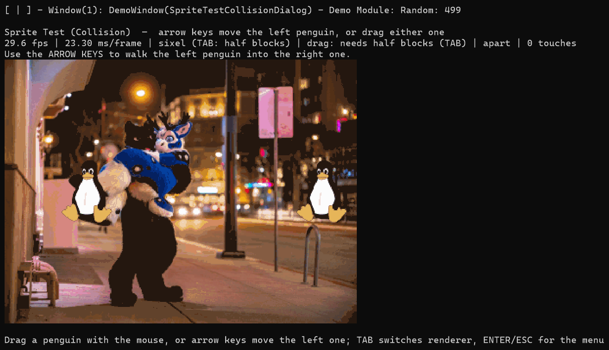
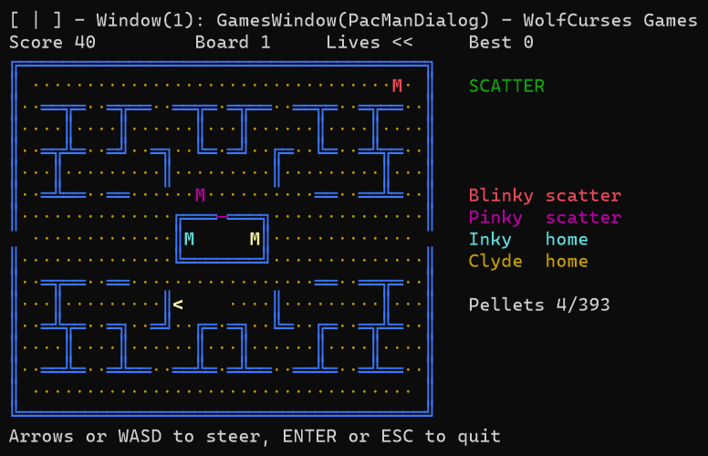
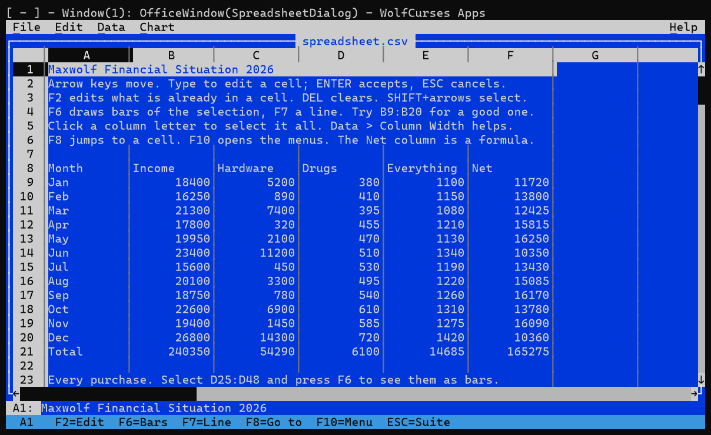

# WolfCurses examples

Three runnable console applications built on [WolfCurses](../README.md). Each is its own project, referencing the library directly.

## [WolfCurses.Demo](WolfCurses.Demo/README.md) - the library tour

Images, sprites, widgets, colour, and every dialog.



## [WolfCurses.Games](WolfCurses.Games/README.md) - the arcade

Ten games, each built on a different part of the library.



## [WolfCurses.Apps](WolfCurses.Apps/README.md) - the office suite

Seven applications: a word processor, BASIC, a spreadsheet, a calculator, a planner, a card file and a media player.



## Running them

```cmd
dotnet run --project example/WolfCurses.Demo
dotnet run --project example/WolfCurses.Games
dotnet run --project example/WolfCurses.Apps
```

All three are terminal UIs, so run them from a real terminal window rather than by double-clicking, and give the window some room.

Prebuilt, self-contained downloads for Windows, macOS and Linux are on the [releases page](https://github.com/Maxwolf/WolfCurses/releases), with all of them in a single archive and no .NET install needed.
